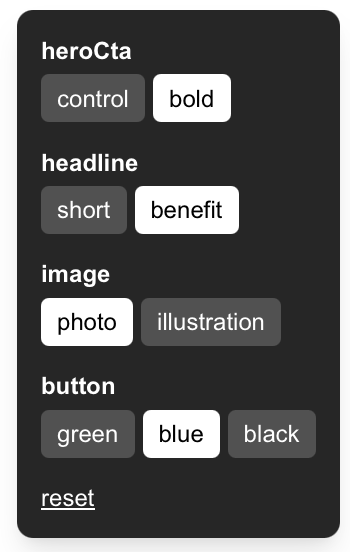

# A/B and Multivariate Testing Demo (Next.js + TypeScript)

A small, dependency-free demo of server-side A/B and multivariate testing with the Next.js App Router. Visitors are assigned to variants deterministically on the server, so there is no flicker, no database, and no third-party service.



## Features

- **Deterministic bucketing:** a hash of `experimentId + visitorId` means the same visitor always sees the same variant.
- **Server-side assignment:** variants are resolved in proxy, so the correct version renders on first paint.
- **Type-safe experiments:** variant names are inferred from one config file. Adding a variant without handling it is a compile error.
- **Multivariate support:** each factor is assigned independently (full factorial design: 2 x 2 x 3 = 12 cells).
- **Exposure tracking:** a beacon is sent when a variant is rendered, logged to the server console for the demo.
- **Demo variant switcher:** force any variant from the UI or the URL to review each version.
- **Simulation script:** verifies the traffic split and the independence of factors.

## Experiments

| Key        | Experiment ID    | Variants (weight)                       |
| ---------- | ---------------- | --------------------------------------- |
| `heroCta`  | `hero_cta_v1`    | `control` (50), `bold` (50)             |
| `headline` | `pm_headline_v1` | `short` (50), `benefit` (50)            |
| `image`    | `pm_image_v1`    | `photo` (50), `illustration` (50)       |
| `button`   | `pm_button_v1`   | `green` (34), `blue` (33), `black` (33) |

All experiments are defined in `lib/experiments.ts`.

## How it works

```
Request
  |
  v
proxy.ts
  - reads or creates the `vid` cookie (visitor ID)
  - assigns a variant per experiment with assign(experiment, vid)
  - applies demo overrides from the URL or `exp_*` cookies
  - forwards results to the page as `x-exp-<key>` request headers
  |
  v
app/page.tsx (server component, inside <Suspense>)
  - getVariants() reads the headers once and returns a typed object
  - renders <Hero /> from the variants
  - renders an <ExposureTracker /> per experiment
  |
  v
Browser
  - ExposureTracker sends POST /api/exposure via sendBeacon
  - the route handler logs the event to the terminal
```

### Why server-side assignment

Client-side assignment renders one version, then swaps it after hydration, which causes visible flicker and skews results. Resolving the variant before render avoids both.

### Why `sameSite: "lax"` on the visitor cookie

With `strict`, the cookie is withheld when a visitor arrives from another site (a search result, email, or ad), so they could be re-bucketed into a different variant. `lax` keeps the assignment stable on those top-level navigations.

## Tech stack

- Node.js 20 or newer
- Next.js 16 (App Router), React, TypeScript
- Tailwind CSS 4
- `tsx` for running the simulation script

## Getting started

```bash
git clone <your-repo-url>
cd <your-repo>
npm install
npm run dev
```

Open [http://localhost:3000](http://localhost:3000).

## Viewing the variants

1. **Use the switcher** in the bottom-right corner of the page.
2. **Use URLs directly:**
   - `/?exp_heroCta=bold`
   - `/?exp_heroCta=control`
   - `/?exp_button=blue`
   - `/?reset=1` clears all overrides and returns to natural assignment
3. **See natural bucketing:** open the site in several incognito windows. Each gets a new `vid` cookie and lands in a variant by hash.
4. **Inspect the mechanics in DevTools:**
   - Application tab, then Cookies: `vid` and any `exp_*` overrides
   - Network tab: `POST /api/exposure`
   - Terminal: `[exposure] { experiment, variant, ts }` lines
5. **Check stability:** refresh repeatedly and the same browser keeps the same variant. Delete `vid` and refresh to be re-bucketed.

## Simulating the traffic split

```bash
npm run simulate
```

This assigns 10,000 random visitor IDs per experiment and prints the share of each variant. Expect results close to the configured weights (for example, roughly 49 to 51 percent on a 50/50 split). A large deviation points to a bug in `assign` or the weights.

## Project structure

```
.
  app/
    api/exposure/route.ts      exposure endpoint (logs to console)
    components/
      hero.tsx                 renders the page from the variants
      exposure-tracker.tsx     client component, sends the beacon
      variant-switcher.tsx     demo UI for forcing variants
    page.tsx                   resolves variants and renders the experience
  lib/
    ab-testing-util.ts         utilities for proxy.ts
    experiments.ts             experiment definitions and types
    assign.ts                  deterministic hash-based assignment
    get-variant.ts             getVariants() / getVariant() helpers
  scripts/
    simulate.ts                traffic split simulation
  proxy.ts                     visitor ID, assignment, overrides
```

## Adding or changing an experiment

1. Add an entry to `lib/experiments.ts`:

   ```ts
   cta: {
     id: "cta_v1",
     variants: [
       { name: "control", weight: 50 },
       { name: "urgent", weight: 50 },
     ],
   },
   ```

2. Handle each variant in your UI. A `Record<Variants["cta"], ...>` map makes TypeScript flag any variant you forget.
3. Run `npm run simulate` to confirm the split.

`getVariants()`, the proxy, and the `Variants` type pick up the new experiment automatically.

**Do not change an experiment `id` or its weights mid-test.** Doing so reshuffles visitors and invalidates the results. Create a new experiment ID instead.

## Analysis guidance

- Decide the primary metric, minimum detectable effect, and sample size before launching.
- Log exposure only when the user actually sees the tested element.
- Join exposures and conversions on the same visitor ID.
- Check for sample ratio mismatch (for example, a 52/48 split on a 50/50 test at large traffic suggests a bug, bot traffic, or caching issues).
- Avoid peeking and stopping early, or use a sequential testing method.
- For a multivariate test, analyse main effects and interactions with a regression rather than comparing all 12 cells pairwise. Traffic needs grow with the number of cells.

## Production notes

This is a demo. Before using the pattern in production:

- **Disable or gate the URL and cookie overrides.** Otherwise anyone can choose their variant and pollute your data.
- **Set `secure: true` on cookies** over HTTPS, for example `secure: process.env.NODE_ENV === "production"`.
- **Respect consent rules.** A visitor ID cookie may need consent depending on jurisdiction.
- **Filter bots** from exposure and conversion data.
- **Handle caching.** Reading request headers makes the page dynamic. For CDN-cached pages, have proxy rewrite to pre-rendered variant routes instead.
- **Add a kill switch,** such as a config flag that forces everyone to control.
- **Persist events.** Replace the console log in `/api/exposure` with your analytics store.

For a managed stats engine, dashboards, and targeting, consider GrowthBook, Statsig, LaunchDarkly, PostHog experiments, or the Vercel Flags SDK. They fit the same proxy and server component pattern.

## Troubleshooting

| Problem                                       | Fix                                                                                                                                     |
| --------------------------------------------- | --------------------------------------------------------------------------------------------------------------------------------------- |
| Error about blocking prerender or `headers()` | The `headers()` call must sit inside a `<Suspense>` boundary when Cache Components is enabled. This project wraps it in `app/page.tsx`. |
| Hydration mismatch                            | Server and client must use the same assignment. Pass variants from the server instead of re-computing them on the client.               |
| Same variant for everyone on a deployed site  | A CDN is caching the page. Use dynamic rendering, vary on the cookie, or use variant routes.                                            |
| `Cannot find module '../lib/assign'`          | Run scripts from the project root. The script uses relative imports because `tsx` does not resolve the `@/` alias.                      |

## Scripts

| Command            | Description                      |
| ------------------ | -------------------------------- |
| `npm run dev`      | Start the development server     |
| `npm run build`    | Build for production             |
| `npm run start`    | Run the production build         |
| `npm run simulate` | Run the traffic split simulation |

## Deploying

Push the repository to GitHub and import it into [Vercel](https://vercel.com/new) or [Netlify](https://app.netlify.com/start). No configuration is needed. Shareable links such as `/?exp_heroCta=bold` let stakeholders review each variant directly.

## Author

Mitch Leung - [GitHub](https://github.com/mitchleung) - [LinkedIn](https://linkedin.com/in/mitchleung)

## License

Released under the MIT License.
